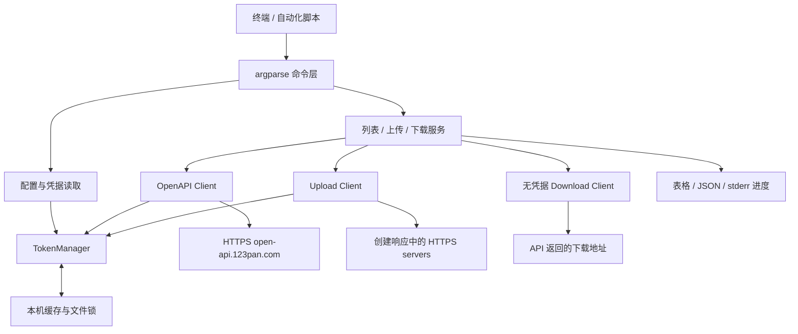
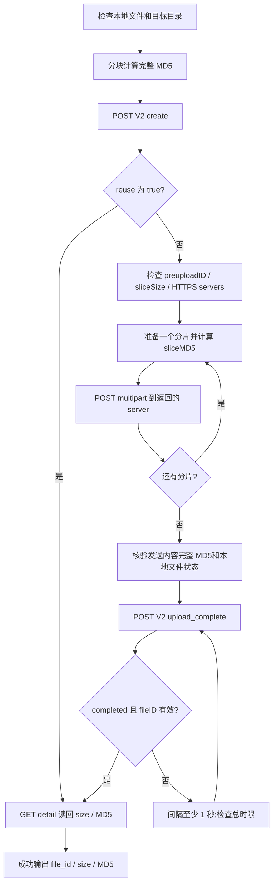

# 123Pan CLI 技术栈与开发文档

版本：0.3 · 更新日期：2026-10-14（Asia/Shanghai）· 状态：CLI 0.1.0 已实现，核心文件链路真实联调通过。

本文用于指导开发一个直接调用 123 云盘开放 API 的本地命令行工具。用户已确定使用本机 `client_id` / `client_secret` 接入，要求独立工程文件夹，并根据 API 文档设计完整 CLI 命令。列表、上传、下载是优先打通的核心链路，完整交付范围包含文档中的全部 API 能力。本文保留设计依据与验收标准，并同步实际实现。具体参数以安装后的 `--help` 为准；来源契约、模拟测试和真实验证分别记录。

CLI 工程目录为 `/Users/vorek/Coding Project/123Pan-CLI`，独立管理源码、虚拟环境、依赖、测试、构建和版本。工程内 `docs/api-source/` 保存全部 API 快照，查阅和开发均以本工程为入口。本工程已包含源码、测试、独立虚拟环境、wheel / sdist 和 CI 配置；实际验证见[真实联调记录](./真实联调记录.md)及[实施进度](./实施进度.md)。

API 基线采用本工程 `docs/api-source/` 保存的官方文档快照，其清单记录采集时间为 **2026-09-11 08:58:08（北京时间）**。2026-10-14 尝试读取官方语雀文档未成功，因此本文不把快照中的配额、上传限制和传输行为表述为已核验的现行规则。开发联调时按第 15 节处理这些差异。

## 官方 API 直连接入约束

所有业务命令由本机 CLI 直接访问官方接口；控制接口统一使用 `https://open-api.123pan.com`。开发者认证由本机向官方 `/api/v1/access_token` 提交 `clientID` / `clientSecret`，并缓存响应中的 `accessToken` / `expiredAt`，业务请求携带 `Authorization: Bearer ...` 和 `Platform: open_platform`。

上传分片连接官方 create 响应中的 servers；V1 上传连接官方返回的 presignedURL；文件下载连接官方返回的 downloadUrl；第三方授权使用官方 OAuth 域名与官方 token 接口。各地址分别遵循本文件的 HTTPS、鉴权与凭据隔离规则。

用户明确要求：调用链路不经过自部署网关，不生成或发送 stoken（用户消息中的 strok），不通过 Appwrite 身份验证。工程配置不提供业务网关地址或网关鉴权选项；任何认证失败都按官方接口错误处理，不切换到其他接入链路。

## 阅读导航

| 读者任务 | 对应章节 |
| --- | --- |
| 了解产品范围与技术选型 | 1—3 |
| 组织代码、划分模块 | 4—5 |
| 实现配置、令牌和 HTTP 客户端 | 6—8 |
| 实现三个核心命令 | 9—11 |
| 对接脚本、定位失败 | 12—13 |
| 开发排期、测试、发布 | 14—16 |
| 核对设计依据与参考资料 | 17—18 |
| 查阅全部命令、每个 API 的参数与返回值 | [完整 CLI 命令参考](./CLI完整命令参考.md) |

## 1. 产品目标与交付范围

工具的目标是让用户在 macOS、Linux、Windows 终端中，使用同一套命令查看云盘目录、上传一个本地文件、下载一个云端文件；脚本能够根据 JSON 输出和退出码判断结果。

命令名设计为 `pan123`，Python 包名为 `pan123_cli`，本地发行包名为 `pan123-cli`。命名用于独立工程开发；公开发行前应核查包名占用及命令冲突。

| 能力 | 首版行为 | 成功标准 |
| --- | --- | --- |
| `list` | 按目录 ID 分页列出文件，可遍历全部分页；支持全局关键词搜索 | 正确使用返回游标，默认过滤回收站文件，输出类型、大小、MD5 |
| `upload` | 将单个本地普通文件上传到指定目录 ID；使用 V2 秒传或分片流程 | 得到有效文件 ID，并读回文件大小与 MD5 验证 |
| `download` | 按文件 ID 获取下载地址，流式下载到本地 | 本地大小与 MD5 校验通过后才发布正式文件 |
| 基础支持 | `--help`、`--version`、配置读取、令牌缓存、JSON、进度、错误码 | 帮助无需凭据，脚本输出稳定，敏感内容不进入日志 |

默认操作对象为文件 ID / 目录 ID；根目录 ID 为 `0`。规范命令使用 `pan123 file list`、`pan123 file upload`、`pan123 file download`，同时保留表中的短命令为兼容别名。完整命令树还包括 `auth`、`oauth`、`user`、`share`、`offline`、`directlink`、`image`、`transcode`；全部接口的参数、输出、历史接口和复合流程见[完整 CLI 命令参考](./CLI完整命令参考.md)。

目录递归、目录同步、上传并发、多账号 profile、跨进程传输恢复是额外产品能力，不作为现有 API 文档覆盖率的替代项。完整 API 覆盖包括旧版文件列表、V1 上传、V2 单步上传、SHA1 上传以及第三方 OAuth；受授权类型或权益限制的命令也必须列出并明确其运行前提。

### 1.1 使用方式

以下命令在按[安装与使用](./安装与使用.md)安装并配置凭据后使用。

```bash
pan123 --help
pan123 list --parent-id 0
pan123 list --parent-id 0 --all --json
pan123 list --search '季度报告' --all
pan123 upload --file './报告.pdf' --parent-id 0
pan123 upload --file './报告.pdf' --parent-id 123456 --duplicate keep-both --json
pan123 download --file-id 123456 --output './报告.pdf'
pan123 download --file-id 123456 --output './报告.pdf' --overwrite --yes --json
```

示例中的远程 ID 是示意值，实际执行时从自己的 `list` 输出选取。凭据配置见第 6 节。

## 2. 独立工程现状与官方契约基线

源码包含 77 个端点/协议命令定义，覆盖官方快照的全部 72 个独立 method/path；同一路径的业务与授权变体分别注册。所有帮助无需网络或凭据。

| 项目 | 当前实现 / 验证 |
| --- | --- |
| API 来源 | 87 篇快照、74 篇接口文档；路由与来源页覆盖通过自动校验 |
| 运行环境 | 独立 `.venv`，本机 macOS ARM64 / Python 3.14.7 |
| HTTP / 配置 | HTTPX 0.28.1、python-dotenv 1.2.4；兼容范围见 pyproject，精确基线见 constraints |
| 构建 | pyproject、pan123 入口、wheel 与 sdist；干净虚拟环境安装入口验证通过 |
| Git / CI | GitHub 私有仓库 vorekkk/123Pan-CLI，分支 `feat/official-cli`；`.github/workflows/ci.yml` 的 12 个任务在 2026-10-14 全部通过（[运行 38486131516](https://github.com/vorekkk/123Pan-CLI/actions/runs/38486131516)），手动 ARM64 任务未触发 |
| 真实业务 | 指定目录 33175809 通过：列表、详情、下载、32,789 B 单分片上传、20,971,528 B 两分片上传、秒传，以及底层 `upload-api v2` create/slice/complete 与重复分片拒绝；2026-10-14 两轮联调证据见[真实联调记录](./真实联调记录.md) |
| 其余领域 | 已实现，模拟契约检查；未执行真实权益/第三方账号验证 |

## 3. 技术栈与选型理由

### 3.1 运行时与开发依赖

| 层次 | 技术 | 选择理由与使用方式 |
| --- | --- | --- |
| 语言 | Python，最低目标版本 3.12 | 与现有仓库一致；验收矩阵覆盖 3.12、3.13、3.14，不能只根据本机运行宣称兼容 |
| 命令解析 | 标准库 `argparse` | 按业务域组织子命令；自动提供帮助与参数检查；设置 `allow_abbrev=False` |
| HTTP | `httpx.Client` | 复用连接，支持 multipart、流式响应、分阶段超时和可替换 Transport |
| 终端展示 | `rich` | 表格、中文显示、进度条；关闭富文本解释，文件名按普通文本渲染 |
| 用户目录 | `platformdirs` | 分别定位配置目录和缓存目录，不把令牌写入工程目录 |
| 跨进程锁 | `filelock` | 对本机共享令牌刷新加锁，对同一路径下载加锁 |
| 显式环境文件 | `python-dotenv` | 通过 `dotenv_values()` 读取 `--env-file`；不自动加载仓库 `.env` |
| 数据模型 | `dataclasses`、`typing`、`enum` | 用明确的内部字段和状态表达业务；避免额外模型框架依赖 |
| 文件处理 | `pathlib`、`tempfile`、`hashlib`、`os` | 块读取、MD5、临时分片、原子文件提交 |
| 时间与退避 | `datetime`、`time.monotonic`、`random` | 有时区的令牌过期比较；不受系统时钟跳变影响的操作时限 |
| 自动化测试 | `pytest` + HTTPX `MockTransport` | 模拟网络和错误响应；测试默认不访问真实账户 |
| 格式与静态检查 | `ruff` + `mypy` | 统一格式、代码规则和模块类型边界 |
| 构建 | `pyproject.toml` + `setuptools` + `build` | 标准 wheel / sdist 与命令入口 |
| 安装 | `pip`，可选 `pipx` | 开发使用虚拟环境，交付使用独立 CLI 环境 |

`argparse` 的子命令与自动帮助能力见 [Python 3.12 文档](https://docs.python.org/3.12/library/argparse.html)。HTTPX 的同步客户端、上传与下载能力见 [Client 文档](https://www.python-httpx.org/advanced/clients/) 和 [QuickStart](https://www.python-httpx.org/quickstart/)。终端进度使用 [Rich Progress](https://rich.readthedocs.io/en/stable/progress.html)，并显式将进度控制台绑定到 stderr。

**版本管理规则：**独立环境验证后的精确基线记录在 constraints-runtime.txt / constraints-dev.txt；本机验证不是其他平台的执行证据。`pyproject.toml` 声明兼容区间，发布另存经过验证的依赖约束文件，运行时依赖与开发依赖分别管理。

### 3.2 为什么采用这套方案

| 方案 | 适配情况 | 本项目决策 |
| --- | --- | --- |
| Python + argparse + HTTPX | 与仓库一致，文件和网络能力足够，开发维护成本较低 | 首版采用 |
| Python + Typer / Click | 适合装饰器式命令定义和类型参数推导 | 当前使用显式 argparse 注册与端点 schema 管理完整命令树 |
| Go / Rust 单文件程序 | 适合无 Python 环境分发；需维护另一语言的实现和构建链 | 有明确独立可执行文件需求后评估 |

首版使用同步串行传输：一个命令处理一个文件，同一时间发送一个分片。连接复用和流式 I/O 已能满足功能需求；上传并发、跨进程恢复和独立可执行文件需要额外服务端行为验证，再单独扩展。

完整命令树按领域注册到 argparse；端点、字段、授权模式与协议特殊处理由 catalog.py 和服务层实现。查询和异步 API 多，不等于要使用 asyncio；不同端点的 HTTP 方法、字段位置和状态机由元数据及适配器决定。

### 3.3 独立运行方式

CLI 在用户终端运行，通过 HTTPS 调用官方开放平台。安装只解析本工程 pyproject 声明的依赖；配置、缓存、测试和构建都在本工程及当前用户目录管理。官方账户凭据是业务调用前提。

## 4. 项目布局与包入口

使用 `/Users/vorek/Coding Project/123Pan-CLI` 作为工程根目录，只以本工程文件为构建输入；独立虚拟环境和依赖约束用于验证。

```text
123Pan-CLI/
├── README.md
├── docs/                       # 技术/命令文档、覆盖、联调、87 篇来源
├── pyproject.toml
├── MANIFEST.in
├── constraints-dev.txt
├── constraints-runtime.txt
├── .env.example
├── .github/workflows/ci.yml
├── scripts/check_wheel.py
├── src/pan123_cli/
│   ├── __init__.py / __main__.py
│   ├── cli.py / catalog.py      # 命令调度、字段 schema 与 wire 映射
│   ├── config.py / auth.py / cache.py
│   ├── client.py / errors.py / output.py
│   ├── services/
│   │   ├── listing.py / sharing.py
│   │   └── uploading.py / downloading.py
│   └── utils/files.py / urls.py
└── tests/                      # 命令、配置、鉴权、catalog、传输与输出
```

包只导出 `pan123_cli`，wheel / sdist 不包含 `.env`、缓存、临时文件或本地下载。API 快照作为开发文档保留，默认不进入 wheel 运行时代码。

以下是已实现 pyproject.toml 的入口片段；完整依赖与工具配置见工程文件：

```toml
[project]
name = "pan123-cli"
version = "0.1.0"
requires-python = ">=3.12"

[project.scripts]
pan123 = "pan123_cli.cli:main"
```

`main(argv: Sequence[str] | None = None) -> int` 返回退出码。`__main__.py` 调用 `raise SystemExit(main())`，使安装后的 `pan123` 与 `python -m pan123_cli` 具有一致行为。包入口配置依据 [PyPA pyproject.toml 指南](https://packaging.python.org/en/latest/guides/writing-pyproject-toml/)。

## 5. 架构与模块契约

### 5.1 请求链路



### 5.2 模块职责

| 模块 | 输入 / 输出 | 必须遵守的边界 |
| --- | --- | --- |
| `cli.py` | argv → 退出码 | 不直接发 HTTP；集中处理异常与输出 |
| `config.py` | 参数、环境、文件 → Settings | 验证数值、路径和凭据完整性；不打印 secret |
| `auth.py` | Credentials → access token | 检查过期、锁内复查、按需重新取 token |
| `cache.py` | 账户指纹、缓存记录 → 文件 | 临时文件写入、权限收紧、原子替换 |
| `client.py` | 类型化 API 参数 → 类型化响应 | 固定控制域名；准确处理业务 code 与字段大小写 |
| `listing.py` | ListOptions → ListResult | 处理游标、筛选与部分结果 |
| `uploading.py` | 本地文件、目录 ID → UploadResult | 哈希、秒传、分片、完成轮询、读回校验 |
| `downloading.py` | 文件 ID、本地路径 → DownloadResult | 无凭据 CDN 访问、流式校验、本地提交 |
| `output.py` | 结果 / 错误 → stdout / stderr | JSON 独占 stdout；终端文本按普通文本处理 |

服务层接受注入的客户端、时钟、sleep 和进度回调。测试可替换 Transport 与等待函数，不通过生产命令增加任意上游域名参数。

### 5.3 内部数据与适配方法

实现使用 `Settings` dataclass、`Field` / `Endpoint` dataclass、受保护的 token / session JSON 记录与服务结果字典。错误统一为 `Pan123Error`；wire 数据在 catalog 与服务边界校验，保留官方字段大小写。无需单独的 models.py 或 commands 目录。

`ApiClient.request()` 接受 method、path 和 params / json；特殊方法处理 multipart、单步上传、外部 PUT 与 CDN 流。catalog.py 管理命令、字段位置、ID 类型、固定业务字段和重试性质。同一个 `/api/v2/file/list` 的普通文件、视频源和转码空间变体分别保留筛选条件。

## 6. 配置、凭据与本机目录

### 6.1 配置来源及优先级

普通设置按“命令参数 → 进程环境 → 显式 `--env-file` → JSON 配置文件 → 内置默认值”合并。必填项缺失、空字符串凭据、无效 JSON 或未知配置键均明确失败，不静默回退。

`client_secret` 从 `PAN123_CLIENT_SECRET`、用户显式指定的环境文件，或认证命令的 `--client-secret-stdin` 读取；不提供接收 secret 值的 `--client-secret` 参数，不写入普通 JSON 配置文件。`client_id` 可以从环境、环境文件、JSON 配置或相应认证命令的 --client-id 读取。两者视为完整凭据对，来源和账户指纹在加载后统一计算，避免重用旧账户 token。

开发者凭据同时兼容 `CLIENT_ID` / `CLIENT_SECRET`。同一来源明确提供 PAN123 名称时以该名称为准（空值仍报错）；高优先级进程来源的别名可覆盖低优先级 env-file。

默认不搜索当前工作目录中的 `.env`。用户希望使用现有环境文件时，必须明确传入 `--env-file`；进程环境仍优先于该文件。环境文件只解析所需变量，忽略本 CLI schema 未声明的变量，不把整个文件内容写入日志。

```bash
# CLI 安装后，显式使用已有凭据文件。
pan123 --env-file ./.env list --parent-id 0
```

下面的 POSIX shell 示例可交互读取凭据并导出，不在命令文本中写入真实 secret；执行 CLI 前需要先完成开发和安装。Windows 用户使用本机环境变量或显式环境文件。

```bash
printf 'client_id: '
IFS= read -r PAN123_CLIENT_ID
printf 'client_secret: '
stty -echo
IFS= read -r PAN123_CLIENT_SECRET
stty echo
printf '\n'
export PAN123_CLIENT_ID PAN123_CLIENT_SECRET
```

### 6.2 设置项

| 设置 | 命令参数 / 环境变量 | 默认值 | 校验与语义 |
| --- | --- | --- | --- |
| client ID | `PAN123_CLIENT_ID` | developer 联网命令必填 | 非空字符串；本地帮助 / 状态与 OAuth 模式不要求开发者凭据 |
| client secret | `PAN123_CLIENT_SECRET` | developer 联网命令必填 | 非空，不参与输出；oauth 模式使用自己的凭据 |
| 鉴权模式 | `--auth-mode` / `PAN123_AUTH_MODE` | developer | developer / oauth；不混用凭据和缓存 |
| 配置文件 | `--config` / `PAN123_CONFIG_FILE` | 用户配置目录下 `config.json` | 默认文件不存在可用内置默认；显式指定文件不存在则失败 |
| 环境文件 | `--env-file` | 无 | 仅按显式路径读取 |
| 缓存目录 | `--cache-dir` / `PAN123_CACHE_DIR` | 平台用户缓存目录 | 可写、属于当前用户范围 |
| 页大小 | `list --limit` | 100 | 整数，1—100 |
| API 超时 | `--timeout` / `PAN123_API_TIMEOUT` | 30 秒 | 有限正数；read / write 空闲超时，不是整个命令总时限 |
| 传输超时 | `--transfer-timeout` / `PAN123_TRANSFER_TIMEOUT` | 120 秒 | 有限正数；上传 write / 下载 read 空闲超时 |
| 完成轮询时限 | `upload --complete-timeout` | 300 秒 | 有限正数，monotonic 总时限 |
| 提前取新 token | JSON `token_refresh_skew_seconds` | 300 秒 | 非负整数；按实际 expiredAt 判断 |
| 只读请求最大重试 | JSON `read_max_retries` | 3 次 | 非负整数；原始请求之外最多 3 次 |
| 输出 JSON | `--json` | 否 | 一个命令只产生一个 JSON 文档 |
| 结构化输入 | `--request-file PATH` | 无 | 用于批量、嵌套参数；`-` 代表 stdin，逐命令按 API 允许字段验证 |
| 明确执行变更 | `--yes` | 否 | 覆盖、删除、禁用或替换配置等命令在非交互环境使用；见命令参考 |
| 异步等待 | `--wait` / `--wait-timeout` | 默认单次 / 300 秒 | 仅对应明确有查询流程的命令；间隔按各 API 文档 |
| 关闭进度 | `--no-progress` | 否 | JSON / 非交互模式自动关闭动态进度 |
| 调试 | `--verbose` | 否 | 仅脱敏诊断信息 |

通用参数允许在子命令前后使用，解析器必须统一实现和测试；示例使用 `pan123 --env-file ... list ...` 与 `pan123 list ... --json` 都应有效。若同一参数在不同位置重复，统一采用最后一次值并在帮助中说明。首版不开放 `--base-url`，OpenAPI 控制域名固定为 HTTPS 官方地址。

认证命令可用非敏感 `--client-id` 指定账户，并用 `--client-secret-stdin` 从 stdin 读取 secret；它是输入来源选择器，不接受 secret 值作为参数。授权码、refresh token 和保险箱密码也采用对应来源选择器。一个调用最多有一个 stdin 消费者，不能同时传 `--request-file -` 和任意敏感 stdin 选择器。

### 6.3 本机文件

通过 `platformdirs` 使用应用名 `123pan-cli`、`appauthor=False`，读取实际平台目录，不手写 OS 判断。目录说明以 [platformdirs 文档](https://platformdirs.readthedocs.io/en/latest/) 为依据。

| 文件 | 存放位置 | 内容 |
| --- | --- | --- |
| `config.json` | `user_config_dir` | 非敏感配置、可选 client ID；schema_version=1 |
| `token-<fingerprint>.json` | `user_cache_dir` | 访问令牌及其到期时间 |
| `token-<fingerprint>.lock` | 同一缓存目录 | 跨进程刷新锁 |
| `*.part` | 最终下载路径所在目录 | 未完成下载文件，文件名附加任务 ID |
| 分片临时文件 | 系统临时目录 | 当前一个分片，结束后关闭并删除 |
| 上传 session / domains 文件 | 用户缓存目录或显式受限输出路径 | low-level 命令所需 preuploadID、服务器或预签名 URL；不含账户 secret / token |
| `oauth-state-<task_id>.json` | 当前 OAuth 应用的用户缓存目录 | state、应用 ID、redirect URI、创建时间；默认 10 分钟有效、交换后单次删除 |

macOS 通常使用 `~/Library/Application Support/123pan-cli` 与 `~/Library/Caches/123pan-cli`；Linux 遵循 XDG 配置与缓存目录；Windows 使用用户 AppData 下的应用目录。实际路径以运行时解析值为准。

POSIX 下凭据缓存文件使用 `0600`、应用私有目录使用 `0700`；Windows 使用当前用户目录和其 ACL，不能把 `chmod(0600)` 当成 Windows 权限验证。缓存是受文件权限保护的本机明文令牌存储；若后续需要操作系统凭据保险库，可另行接入 Keychain / Credential Manager。

低层 upload-api create 成功后写受保护 session 文件，`--session-out` 可指定路径，否则写到账户缓存下随机任务文件；后续命令通过 `--session-file` 读取。domains 命令通过 `--domains-out` 保存经验证的服务器列表。状态文件使用 schema_version=1，绑定鉴权模式、账户指纹、API 版本、文件哈希/大小和服务端来源；即使手动传入文件，也重新校验字段和目标。预签名 URL、preuploadID 是能力信息，不默认完整打印。写入受限状态文件是低层分步操作支持，不表示自动断点恢复已经实现。

## 7. 令牌获取、复用与刷新

### 7.1 官方鉴权契约

控制域名固定为 `https://open-api.123pan.com`。取 token：

| 项目 | 契约 |
| --- | --- |
| 方法与路径 | `POST /api/v1/access_token` |
| 请求头 | `Platform: open_platform`；`Content-Type: application/json` |
| JSON 字段 | `clientID`、`clientSecret` |
| 成功响应字段 | `data.accessToken`、`data.expiredAt` |
| 业务成功 | HTTP 成功且 JSON `code == 0` |

每次命令应先复用缓存。快照称同一 client ID 最多有 3 个使用中的 token、token 有效期为 30 天；实际期限始终使用响应 `expiredAt`，不硬编码 30 天。不同机器之间不能由本机文件锁协调，共用账户时尤其应避免频繁签发。

### 7.2 缓存算法

1. 对 `client_id + 分隔符 + client_secret` 计算 SHA-256 作为凭据指纹；不保存原始 secret，也不在用户输出中展示指纹。
2. 读取对应 token 缓存，检查 schema、凭据指纹与字段类型。
3. 将 `expiredAt` 解析为带时区时间，统一转 UTC；无时区、非法格式按无效缓存处理，不擅自猜时区。
4. 当到期时间晚于“当前 UTC + 提前量”时直接复用。
5. 否则获取同账户刷新文件锁，锁等待上限 30 秒；获得锁后再次读取缓存，避免重复签发。
6. 仍无有效记录才调用取 token 接口。响应无效或有效期不足提前量时明确失败，不进入无限刷新循环。
7. 写到同目录独占临时文件，设置权限、flush / fsync，再原子替换缓存；始终在 finally 中释放锁。

跨进程锁行为参考 [filelock 文档](https://py-filelock.readthedocs.io/en/latest/)。锁管理同时测试超时、进程退出与缓存损坏恢复。

### 7.3 认证失效与重发边界

HTTP 401 或 JSON `code=401` 均可能表示凭据失效。先锁内检查缓存是否已被其他进程替换；相同旧 token 才失效缓存并重新获取。一次业务请求最多触发一次重新认证。

列表、详情、下载地址等只读 GET 可在重新认证后重发。上传 create / slice 的未知结果不能因 token 刷新就盲目重放：首版向用户报告失败并保留任务诊断信息；只有服务端明确保证某个拒绝发生在写入前，并通过联调验证后，才放宽该动作的重发策略。完成轮询按第 10 节的会话状态处理。

`--help`、`--version`、本地参数错误必须在任何 token 获取、缓存目录创建与网络请求之前完成。

### 7.4 第三方 OAuth 适配

完整命令参考还覆盖第三方应用授权。默认的 developer 鉴权使用用户选择的开放平台 client ID / secret；需要第三方应用授权的接口使用 oauth 模式，应用 appId / secretId 与开发者凭据分别配置，不把两者视为等价账户权限。

OAuth 使用 `PAN123_OAUTH_CLIENT_ID`、`PAN123_OAUTH_CLIENT_SECRET`、`PAN123_OAUTH_REDIRECT_URI`。提供 authorize-url、exchange、refresh 命令；授权 URL 参数、token 交换位置和 scope 按对应文档发送。授权码和 refresh token 从环境或 stdin 读取，不作为直接 argv 值。

OAuth token 响应为裸对象，适配 `access_token`、`refresh_token`、`expires_in`、`token_type`、`scope`，建立独立带模式和账户身份的缓存。expires_in 从接收时刻折算为 UTC 过期时间，refresh token 与 access token 在同一受限记录中原子更新。

refresh token 单次使用，刷新会使旧 access token 失效。刷新前加锁并复查最新缓存；超时导致结果未知时，不自动重发同一 refresh token，要求重新授权。authorize-url 默认生成不可预测 state 并保存绑定应用与回调的待授权记录；显式 --state 用于外部集成的一次性 state 输入，必须非空且不得覆盖未完成记录。exchange 校验收到的 state、绑定关系和本地有效期，校验通过后消费待授权状态，交换结果未知也不能重复消费。10 分钟是 CLI 的本地设计有效期，不声称是平台授权码 TTL。回调注册和应用授权资格是联调前提，不假设普通开发者账户天然具有这些权限。

## 8. HTTP 客户端与 API 字段契约

### 8.1 三类连接的职责

| 连接 | 目标 | 请求凭据 | 重定向策略 |
| --- | --- | --- | --- |
| OpenAPI Client | 固定 `open-api.123pan.com` | Bearer token + Platform | 默认不跟随 |
| Upload Client | 当前 create 响应中的 `servers` | Bearer token + Platform | 默认不跟随，不向其他域转发凭据 |
| Download Client | `downloadUrl` 及经校验的 CDN 跳转 | 不附带 OpenAPI token / secret | 有界手动跟随，逐跳验证 |

客户端使用 context manager 关闭连接。HTTPX `Client` 的连接复用见 [官方说明](https://www.python-httpx.org/advanced/clients/)。超时分别设置 connect=10 秒、pool=10 秒，API read / write 使用 API 超时，文件传输 read / write 使用传输超时。HTTPX 超时控制的是各阶段等待，业务总时限另行维护，见 [Timeouts](https://www.python-httpx.org/advanced/timeouts/)。

### 8.2 首版接口表

| 用途 | 方法 | 路径 | 请求位置与精确字段 |
| --- | --- | --- | --- |
| token | POST | `/api/v1/access_token` | JSON：`clientID`、`clientSecret` |
| 列表 | GET | `/api/v2/file/list` | query：`parentFileId`、`limit`、`lastFileId`、`searchData` |
| 详情 | GET | `/api/v1/file/detail` | query：`fileID` |
| 下载地址 | GET | `/api/v1/file/download_info` | query：`fileId` |
| 创建上传 | POST | `/upload/v2/file/create` | JSON：`parentFileID`、`filename`、`etag`、`size`、可选 `duplicate`、`containDir` |
| 上传分片 | POST | `<server>/upload/v2/file/slice` | multipart：`preuploadID`、`sliceNo`、`sliceMD5`、`slice` |
| 完成 / 查询完成 | POST | `/upload/v2/file/upload_complete` | JSON：`preuploadID` |

除取 token 外，上述 API 按对应域名携带 `Authorization: Bearer ...` 与 `Platform: open_platform`。JSON 请求让 HTTPX `json=` 生成 Content-Type；multipart 让 `files=` / `data=` 生成 boundary，不能手写一个不带 boundary 的 Content-Type。

内部模型统一使用 snake_case。列表返回 `fileId` / `parentFileId`，详情返回 `fileID` / `parentFileID`，上传返回 `fileID` / `preuploadID`；这些别名必须在每个接口中显式处理。

### 8.3 响应校验

常规开放 API 响应先看 HTTP 状态，再看 JSON 对象和业务 `code`。HTTP 200 且 `code != 0` 是业务失败；HTTP 失败即使响应 code 为 0 也不能成功。取 token、列表、详情、创建上传、完成接口分别验证必需 data 字段。OAuth token 接口的快照展示裸 token 对象，需要独立响应适配器；V1 预签名 PUT 和 CDN 文件下载按各自传输契约处理，不能统一要求 code/data。

V2 slice 的文档写“返回数据无”，响应示例仍为 JSON `code=0, data=null`；首版校验业务 envelope，不能沿用 V1 预签名 PUT 的“空响应 200 即成功”。若真实 V2 返回空体，需要记录契约差异并确认兼容规则。

保留错误响应的 `code`、`message`、`x-traceID` 与 HTTP 状态。正文非 JSON、字段类型不符、`sliceSize <= 0`、有效文件 ID 缺失等均归入协议错误，不能以默认值假装成功。

GET 参数位置不能只根据 HTTP 方法推断：批量复制进度文档示例是 GET JSON body，保险箱文档的参数表与 GET query 示例也有差异。以命令参考逐端点映射并设置真实联调验证项；客户端通过 `request()` 显式支持文档要求的 body，不能用统一“GET 一律 query”的分发器。

### 8.4 URL 与凭据投递

OpenAPI 使用固定 HTTPS。上传服务器只从当前成功 create 响应获取，检查 URL 无 userinfo、无 query / fragment，且为合法 HTTPS origin；不接受用户自行指定上传域名。文档示例存在 HTTP 地址冲突，处理见第 15 节，不自动降级或未经验证改写地址。

下载 URL 作为临时能力地址使用，不输出到默认日志。仅允许 HTTPS；按 URL 返回的内容身份做文件校验，不根据 URL 后缀猜测文件内容。重定向最多 5 次，每一跳重新校验协议、userinfo、主机和目标；拒绝回环、链路本地与私有地址，解析结果校验与连接目标保持一致。下载连接不继承 API 默认 headers，避免带出 Bearer 或 secret。

## 9. 文件列表的开发规范

### 9.1 命令参数

规范命令为 `pan123 file list`，`pan123 list` 是同义入口。

| 参数 | 默认值 | 行为 |
| --- | --- | --- |
| `--parent-id ID` | 0 | 非负整数目录 ID |
| `--limit N` | 100 | 上游每页数量，1—100；过滤后可见行数可能少于该值 |
| `--last-file-id ID` | 不传 | 非负整数；显式从某个 API 游标继续 |
| `--all` | 否 | 按游标遍历，直到 API 返回 -1 |
| `--search TEXT` | 不传 | 发送 searchData，API 将全局搜索并忽略 parentFileId 的目录限制 |
| `--include-trashed` | 否 | 同时展示正常和回收站条目 |

普通表格展示 ID、类型、名称、大小、MD5、回收站状态和审核状态。表格大小可以用可读单位，JSON 保留精确字节整数。`--search` 的帮助必须说明是全局搜索。

### 9.2 分页算法

1. 首次请求不传 `lastFileId`，除非用户给了 `--last-file-id`。
2. 解析当前页 `fileList` 和返回的 `lastFileId`，并检查必需字段类型。
3. 按 `trashed` 过滤输出；不因过滤后结果为空就停止。
4. 没有 `--all` 时返回这一页与可用于下一次调用的游标。
5. `--all` 时只有原始返回游标为 `-1` 才自然结束，其余游标原样传给下一页。
6. 重复游标、非法游标或超过本地最大页数 10,000 时失败，防止无穷循环；错误附带最后游标与已取得页数。

全部分页结果不是事务快照，查询期间远程文件可能变化。不要用最大文件 ID、结果数量或“少于 limit”自行推算结束。JSON 聚合占用内存与结果条目数相关，文件传输的固定内存策略并不表示无限量列表也占固定内存。

### 9.3 中途失败的输出

单次命令只输出一个最终 JSON。分页中途失败时使用 `ok=false`、`partial=true`，附带已获取条目、最后成功游标、失败页游标；不得把部分列表包装为成功。表格可显示已经取得的数据，但 stderr 和退出码必须体现未完成。

## 10. 文件上传的开发规范

### 10.1 命令与前置检查

规范命令为 `pan123 file upload --file PATH --parent-id ID`，短入口 `pan123 upload` 等价。高层文件上传默认 V2 分片；V1、V2 单步及 SHA1 能力另有完整命令映射，不因高层默认策略省略这些 API。

| 参数 | 默认值 | 行为 |
| --- | --- | --- |
| `--file PATH` | 必填 | 一个本地普通文件；允许中文和空格路径 |
| `--parent-id ID` | 0 | 非负目录 ID；非零目标先验证为可用目录 |
| `--name NAME` | 本地文件名 | 远程文件名，不接受路径片段 |
| `--duplicate error` | 默认 | 不主动覆盖，省略 duplicate；同名失败按上游 code/message 展示 |
| `--duplicate keep-both` | 选填 | duplicate=1，上游自动追加后缀 |
| `--duplicate overwrite` | 选填 | duplicate=2，按命令变更规则明确执行 |
| `--complete-timeout SECONDS` | 300 | 等待上传完成的总时限 |

校验文件存在、可读取且为普通文件；拒绝目录、设备、FIFO。远程文件名不得全为空格，不含 `" / \\ : * ? | > <`；快照长度描述存在“小于 256”与“小于 255”的差异，客户端保守采用最多 254 个 Python 字符，并在联调中验证平台的 Unicode 计数方式。

快照标注单文件上限 10GB，但未定义 GB 的具体字节数。设计不擅自等同为 10GiB；实际字节门槛在联调确认后写入集中限制配置。该限制必须在远程 create 前验证。空文件是否被平台接受也需要真实联调，不能只凭模拟测试宣称支持。

### 10.2 状态与数据流



当 `reuse=true` 时要求有效 `fileID`，不要求响应含有 `preuploadID`、`sliceSize` 或 `servers`。`reuse=false` 时才验证会话字段。`fileID=0` 不能作为成功结果。

### 10.3 分片与内存策略

完整文件 MD5 使用固定 1 MiB 块读取，不使用 `read_bytes()`。记录文件 size、mtime_ns 及可用的文件身份信息，并在后续阶段复查。

分片必须使用服务端 `sliceSize`。分片数量为 `ceil(size / sliceSize)`，编号从 1 开始；最后一个分片可以小于 sliceSize。不要向 API 自行设置分片大小，也不要把整个文件读入内存。

每次只准备一个 `SpooledTemporaryFile(max_size=8 MiB)`，边读本地数据边计算分片 MD5；达到阈值时溢写临时磁盘。这里的 8 MiB 是内存溢写阈值，临时磁盘需求仍可接近一个完整 `sliceSize`；空间不足归入本地 I/O 错误。使用依据见 [Python tempfile 文档](https://docs.python.org/3.12/library/tempfile.html)。

上传前把分片文件指针 `seek(0)`，交给 HTTPX multipart 流式读取。表单字段分别为 `preuploadID`、字符串形式的 `sliceNo`、`sliceMD5` 和文件字段 `slice`。成功后关闭当前分片，再准备下一片。

将所有实际准备并发送的分片内容按顺序计算一个完整 MD5，完成前与最初文件 MD5、大小及文件状态比对。发现源文件变化即停止完成请求，避免报告错误的本地版本已经上传。该策略最多暂存一个分片，开销与文件总大小不线性增长；CLI 自身的数据缓冲目标不超过约 16 MiB，实际 RSS 还包括解释器和 HTTP 库，需用大文件实测验证。

### 10.4 完成、校验及超时

所有分片成功后向 **OpenAPI 控制域名** 调用 `/upload/v2/file/upload_complete`，不是向上传服务器发送。`completed=false` 时隔至少 1 秒重查同一接口；`completed=true` 且 fileID 为有效正整数才进入读回阶段。

对远程 fileID 调用详情接口，要求返回文件 ID 一致、type 为文件、大小与本地一致、etag 为相同的完整 MD5；同时输出上游实际文件名，不能假定 keep-both 时名称不变。如果详情存在短暂可见延迟，只读查询最多在 10 秒内有限等待，然后报告 `VERIFY_FAILED`，保留 fileID 供排查。

完成超时、网络断开或验证失败都使用非零退出码，错误中记录非敏感 fileID / 会话状态、已完成分片数及最后 trace ID。`preuploadID` 属于会话能力信息，可保存在本机受限诊断文件，默认用户日志不完整展示。没有文档化取消 API 时，不自动删除远程文件来“回滚”。

### 10.5 V1 与其他上传能力

旧版 V1 采用：create → get_upload_url → 对 presignedURL 原始二进制 PUT → upload_complete → 必要时 upload_async_result。预签名 PUT 不附带 Authorization / Platform；其空响应成功规则与 V2 multipart 不同。CLI 的 V1 适配器单独实现，不能以改路径方式复用 V2 表单。

图床上传是 OSS V1 专属接口及字符串 ID；本地视频转码上传指南要求使用 V1 file create 并指定转码空间目录。V2 单步上传另有先取域名的流程，快照标注 1GB；SHA1 上传也有独立入参。各自完整规范见命令参考。

首个交付阶段不承诺跨进程上传恢复。V2 会话有效期、已上传分片查询、重复分片幂等和服务器切换后的会话共享尚无足够契约；保存诊断 checkpoint 不等于已经支持恢复。

## 11. 文件下载的开发规范

### 11.1 命令与路径

规范命令为 `pan123 file download --file-id ID`，短入口 `pan123 download` 等价。`file download-url` 只返回地址，实际下载命令另外实现完整本地校验。

| 参数 | 默认值 | 行为 |
| --- | --- | --- |
| `--file-id ID` | 必填 | 正整数；不能下载目录 |
| `--output PATH` | 当前目录下的远程文件名 | 已存在的目录会追加远程文件名；父目录必须存在 |
| `--overwrite` | 否 | 校验成功后允许替换已存在的普通目标文件；非交互环境同时传 --yes |
| `--json` | 否 | 成功结果含绝对路径、大小、MD5 与 verified |

先查询详情，检查 `type=0`、`trashed=0`、审核状态可用，取得 size 与 MD5。`status>100` 是文档定义的审核驳回状态，必须明确报告。

自动采用远程名称时，只接受单个安全文件名，拒绝路径穿越、绝对路径、控制字符和当前 OS 不允许的保留名称。名称无效时要求用户选择 `--output`；不静默把危险路径变成另一位置。目标为目录、符号链接或特殊文件时失败，即使用户指定 overwrite，也不能跟随最终目标符号链接写入。

### 11.2 流式写入与完整性

1. 目标目录校验后，对该输出路径取得本机锁；检查默认禁止覆盖规则。
2. 查询 `/api/v1/file/download_info?fileId=...`，提取下载 URL。
3. 使用不带 API 凭据的 CDN 客户端发起 GET，设置 `Accept-Encoding: identity`，逐跳处理安全的 HTTPS 重定向。
4. 若 CDN 返回非 identity 的 Content-Encoding，则明确失败；使用 `iter_raw()` 分块读取，避免 HTTP 自动解压影响文件字节、MD5 和长度。
5. 在目标目录独占创建 `<filename>.<task_id>.part`，使用 1 MiB 块写入，并同时计算 MD5 和总字节数。
6. 检查实际大小与详情 size 一致；如有可信 Content-Length，也检查一致。实际字节数超过预期时提前停止。
7. 检查本地 MD5 与详情 etag 一致；不能把 CDN 自己的 ETag 当成云盘 MD5。
8. 校验成功后 flush / fsync、关闭文件，再按下面的提交策略发布正式文件。

### 11.3 本地文件提交

默认不覆盖采用同目录临时文件加原子不覆盖发布：在支持硬链接的本地文件系统上使用 `os.link(part, final)`，目标已存在则失败，再删除 part 链接。CLI 的路径锁只能协调自身进程，不能替代该不覆盖原语。

若文件系统不支持所需原语，返回明确本地 I/O 错误并保留已校验 part；不能偷偷回退到 `exists()` 后 `os.replace()`，该组合会与其他程序竞争并覆盖其新文件。macOS、Linux、Windows 的目标文件系统都需要实测。

用户显式指定 overwrite 时，仍先完成临时文件校验，再用 `os.replace()` 替换普通目标文件；同目录保证替换不跨文件系统。失败下载不得破坏已有目标文件。目录、最终符号链接及特殊文件的检查应在提交前再次执行。

### 11.4 失败和中断

大小 / MD5 不符、连接中断、磁盘已满、Ctrl-C 时保留 `.part`，输出路径与失败原因，正式文件不产生或不替换。以后再次执行从新临时文件重新开始，不自动使用旧 `.part`，也不自动清理用户的历史 `.part`。

下载流量不足 code 5113、文件不存在 code 5066 按原始 code/message 报告，不做无限重试。链接失效且尚未写入任何字节时，可以有限重新获取地址一次；已经接收部分内容后停止当前尝试，避免不明确的续写或混合版本。

首个交付阶段不启用 Range 下载恢复。后续需验证 `206`、精确 Content-Range、文件身份和链接更新后的内容一致性，才能增加 `--resume`。

## 12. 全命令的输出与输入协议

### 12.1 stdout / stderr

| 通道 | 内容 | 行为 |
| --- | --- | --- |
| stdout | 人类结果表格或最终 JSON | JSON 模式不混入日志、进度、确认文字 |
| stderr | 错误、提示、脱敏诊断、交互进度 | 非 TTY / JSON 模式禁用动态进度 |
| stdin | `--request-file -` 或敏感输入选择器 | 同一命令只允许一个消费者；冲突参数在发请求前拒绝 |

文件名和上游 message 均按普通文本输出，过滤终端控制字符，不解释 Rich markup 或 ANSI 控制序列。JSON 使用 UTF-8、`ensure_ascii=False`，保留数据本身，不把终端展示清理后的名称写回 API。

启动时把 stdout / stderr 重配置为 UTF-8（`errors="replace"`，Windows 控制台本就使用 Unicode API）：中文帮助、中文文件名和中文错误在 ANSI 代码页管线下必须仍能写出，不能因为编码异常把成功命令变成退出码 2。该行为由 `tests/test_cli.py::test_legacy_windows_encoding_cannot_break_help_or_json_output` 用 `PYTHONIOENCODING=cp1252` 子进程覆盖。

### 12.2 成功与失败 JSON

下面展示拟定输出结构；数值与路径为示例，不是实测结果。列表、上传、下载使用规范化 data；其余端点可以保留 API data 的原始字段大小写，由命令参考明确输出字段。

```json
{
  "ok": true,
  "schema_version": 1,
  "command": "file upload",
  "data": {
    "file_id": 123456,
    "filename": "报告.pdf",
    "size": 1024,
    "md5": "0f343b0931126a20f133d67c2b018a3b",
    "reused": false,
    "verified": true
  }
}
```

```json
{
  "ok": false,
  "schema_version": 1,
  "command": "file download",
  "error": {
    "kind": "UPSTREAM_ERROR",
    "message": "下载流量不足",
    "http_status": 200,
    "api_code": 5113,
    "trace_id": "example-trace",
    "retryable": false,
    "details": {"file_id": 123456}
  }
}
```

分页结果的 data 使用 `items`、`next_cursor`、`pages_fetched`、`complete`。一页请求返回 next_cursor 非 -1 时 complete=false，但这不是命令失败，因为用户仅请求一页；`--all` 中途失败则使用 ok=false 和 partial=true。

所有 token 类命令只输出授权方式、到期时间、scope、缓存状态等摘要，token/secret/refresh_token 默认不回显。分享链接、直链和 download-url 等业务本身返回的能力地址可作为明确请求的结果输出，但诊断日志必须脱敏。

### 12.3 批量输入和变更动作

嵌套参数、数组和批量重命名使用 `--request-file`，文件必须是 UTF-8 JSON，并按对应 API schema 校验。标量参数用 kebab-case flags，wire 字段保留原始大小写。禁止将任意未知键透明转发至 API；未文档化的字段需要契约更新。

对删除、覆盖、禁用、付费分享修改和策略替换等有实质影响的命令，交互终端展示明确操作摘要，`--yes` 跳过该提示；非交互环境缺少 --yes 时在网络请求前失败。普通读取、正常创建和上传默认不增加交互步骤。具体动作级别由命令参考列明，不能对所有 POST 统一弹确认。

### 12.4 退出码

| 退出码 | 场景 |
| --- | --- |
| 0 | 完成用户请求；帮助和版本也返回 0 |
| 1 | 未分类的内部错误；生产输出仍脱敏 |
| 2 | 参数、配置、结构化输入或确认条件错误 |
| 3 | 凭据缺失、鉴权失败、token 获取失败 |
| 4 | 网络失败、HTTP 失败或上游业务错误 |
| 5 | 文件 I/O、目标冲突、临时空间不足 |
| 6 | 上传完成等待超时 / 异步任务等待超时 |
| 7 | 响应协议错误、远程读回失败、大小 / MD5 校验失败 |
| 130 | Ctrl-C 中断 |

JSON 模式下参数错误也应输出统一 JSON 到 stdout，简短提示到 stderr；解析器需要先识别输出模式并集中处理 error，不直接让 argparse 把错误内容混入协议。

## 13. 重试、限流与诊断规则

### 13.1 按操作语义重试

| 操作 | 可自动重试的情况 | 禁止或需验证的情况 |
| --- | --- | --- |
| 只读 GET | 建连失败、429、502/503/504；最多 3 次重试 | 永久业务错误、无效输入、无法解释的协议响应 |
| 只读 POST | 端点注册明确标记为只读后采用相同策略 | 不能因为 POST 名称像查询就默认可重试 |
| token 签发 | 锁内只发一个请求，明确限流时有界等待 | 发送后超时结果未知，不循环签发 |
| 上传 create / slice | 发请求前可恢复的本地错误不算网络重试 | 服务端可能已接受后的连接中断不盲目重复写入 |
| upload_complete | 文档规定的 completed=false 轮询 | 未确认的任意错误不得解释为上传完成 |
| OAuth refresh | 明确拒绝时依据错误处理 | 单次令牌结果未知不得重放 |
| CDN 下载 | 尚未收到文件字节前可有限重建连接 | 已收部分内容后不直接拼接 / 自动恢复 |
| 创建 / 修改 / 删除 / 移动等 | 明确文档化的幂等策略才开放 | 默认不自动重放结果未知的变更 |

只读请求采用指数退避基础 0.5 秒、最大 8 秒并添加随机抖动；有效 Retry-After 优先，等待仍受操作总时限约束。重试次数含义为“初始请求之外的额外次数”，帮助、配置和测试保持一致。

异步任务的查询端点及终态已被文档定义、但未规定间隔时，CLI 的 --wait 默认间隔 2 秒，这是本地调度设计。平台已规定或建议 1 秒 / 10 秒的接口遵守各自要求。状态只有“结束”且伴随失败数量时，必须检查失败计数，不把任务退出等待等同于所有条目成功；缺少终态契约的查询不开放猜测式轮询。

API QPS 快照与实际规则可能变化。核心列表顺序分页按本地默认约每秒 1 次请求调度，认证签发按缓存复用控制；同一 client ID 的其他程序不受本机限流器控制。不要把客户端调度值写成平台官方上限。具体 QPS、图床批量大小及转码轮询间隔在对应命令参考和来源文档中列明。

### 13.2 诊断字段与脱敏

每次命令分配本地 task_id，用于关联阶段、耗时、分片、输出文件与 trace_id。默认输出简短可执行错误；verbose 可以增加方法、路径、重试次数与阶段耗时。

不记录 `client_secret`、Authorization、access token、refresh token、授权码、保险箱密码、完整预上传能力标识。遇到 OAuth query 中的敏感字段和下载签名 URL，异常字符串也必须先清理 query，再进入日志；不要直接打印 HTTPX 异常或原始请求对象。分享提取码、付费链接等按敏感业务字段处理。

### 13.3 本地状态清理

临时上传分片在 finally 中关闭；token 缓存临时文件失败时清理；下载失败保留 `.part` 并明确输出实际路径。锁文件是否长期留存按 filelock 实现处理，不把“存在 lock 文件”等同于“锁一直被占用”。

auth clear 只清理本机对应模式 / 账户的缓存，不能宣称已经注销或撤销平台 token；API 快照没有相应撤销接口。程序正常结束、异常、Ctrl-C 都关闭 HTTP 客户端和本地文件。

## 14. 开发任务与交付顺序

完整交付目标是文档中所有 API 都有对应可用命令；下面的阶段是实现依赖顺序，不减少完整命令范围。各阶段代码已经实现；当前执行证据和仍未进行的真实验证列于实施进度。

| 阶段 | 实现工作 | 交付物 | 验收门槛 |
| --- | --- | --- | --- |
| D0 | 工程、文档、API 盘点 | 独立目录、技术文档、完整命令参考、API 覆盖清单 | 所有 87 篇来源均有命令或指南归属 |
| D1 | 包骨架、argparse、配置、输出、异常 | pyproject、规范命令树、支持模块 | help/version 无网络；参数错误与 JSON 协议正确 |
| D2 | HTTPX、开发者 token 缓存、wire 适配 | Client、TokenManager、端点注册 | 协议、缓存并发、鉴权重发边界验证 |
| D3 | list / detail / download_info | 核心查询命令与分页 | 多页、回收站、重复游标、字段大小写测试 |
| D4 | V2 upload / download 业务链路 | 分片、完成轮询、读回、流式下载 | 真实上传与下载大小 / MD5 一致 |
| D5 | 文件全管理、V1 / 单步 / SHA1、分享、离线、用户 | 对应完整命令及类型适配 | 每个 API 的方法、参数位置、错误、输出验证 |
| D6 | 直链、黑名单、图床、转码全命令 | 域服务与复合流程 | 每域的 ID 类型、任务状态与权限验证 |
| D7 | 第三方 OAuth 与受限能力 | OAuth 生命周期和作用域适配 | 刷新旋转、授权 state、权限不足正确退出 |
| D8 | 跨平台、发行包、文档同步 | wheel、sdist、依赖约束、发行说明 | 安装测试与真实联调证据满足第 16 节 |

D5 / D6 的独立只读适配可以在 HTTP 客户端稳定后并行开发；涉及共享认证、响应 schema 和传输工具的修改需先统一接口。命令注册以领域 schema 管理，避免为几十个端点分别复制认证和错误处理。

### 14.1 当前可运行的来源核验

以下命令在独立 CLI 工程运行，只读检查来源和覆盖信息，不调用远程 API：

```bash
cd '/Users/vorek/Coding Project/123Pan-CLI'
python3 -m json.tool docs/API覆盖清单.json
python3 -m json.tool docs/api-source/_manifest.json
rg -n 'open-api.123pan.com|Authorization|Platform' docs/api-source/接入指南/开发者接入/开发须知.md
```

### 14.2 开发环境操作

以下流程在独立工程执行；使用 constraints 可重建本机验证的依赖基线。

```bash
cd '/Users/vorek/Coding Project/123Pan-CLI'
python3 -m venv .venv
.venv/bin/python -m pip install -e '.[dev]' -c constraints-dev.txt
.venv/bin/python -m pan123_cli --help
.venv/bin/python -m pytest tests -q
.venv/bin/python -m ruff check src tests
.venv/bin/python -m ruff format --check src tests
.venv/bin/python -m mypy src/pan123_cli
.venv/bin/python -m build
```

Windows 同一流程用 `.venv\Scripts\python.exe`。测试仅从独立工程运行，使用本工程独立虚拟环境验证安装与运行。

## 15. API 差异与联调事项

这里列出已观察到的文档问题及明确处理动作。它们是后续真实接口验证的输入，不能通过补一个模拟响应就宣布解决。

| 编号 | 文档观察 | 开发处理 / 真实验证 |
| --- | --- | --- |
| C01 | V2 servers 与 slice 示例为 HTTP，公共须知要求 HTTPS | 核查真实响应及官方支持的 HTTPS 上传地址；不自动明文发送 Bearer |
| C02 | V2 未明确会话时长、分片重放、list-parts、取消接口 | 首阶段不承诺恢复；验证前不自动重放结果未知的 slice |
| C03 | 10GB / 单步 1GB 未给精确字节数 | 向官方 / 实际权益核验边界；不能用 GiB 替代 |
| C04 | 文件名长度小于 255 / 256 不一致 | 保守 254 字符；验证 Unicode、空文件和极限大小 |
| C05 | 列表含回收站且使用 -1 结束 | 全过滤空页仍继续；分页依照原始游标 |
| C06 | OAuth token 返回裸对象且 refresh token 单次有效 | 独立解码与原子旋转，失败结果未知时重新授权 |
| C07 | 某些 GET 的 query / body 表格与示例不一致 | 逐端点参考保留差异；用真实请求确认参数位置 |
| C08 | 图床文件 ID 为 string，mkdir name 类型表与示例不同 | 不套用整数云盘模型；逐字段保留源契约差异 |
| C09 | 直链黑名单字段首字母大写、路径含 forbide-ip 拼写 | 精确使用 Status / IpList / Done 和原始路径 |
| C10 | 图床流程提到已上传分片查询，但没有对应图床端点 | 不发明 oss list-parts API；记录接口缺口 |
| C11 | 三方转码列表限定第三方授权 token | 权限 / 模式校验，不能使用开发者 token 承诺该能力 |
| C12 | 转码 resolution / 全部下载地址为异步流程，间隔有专门要求 | 按各端点的状态定义及 10 秒要求等待，不沿用文件上传 1 秒 |
| C13 | 下载文档未定义 Range、URL 时效及 CDN ETag | 流式 MD5 / size 保证本地完整性；恢复能力单独验证 |
| C14 | 视频多分辨率、下载打包、OSS 复制的字段名、枚举和条件必填与普通文件不同 | 按完整参考逐命令建模；任务“结束”不自动等同于全部成功 |

联调记录应保存方法、去敏路径、字段名、HTTP 状态、业务 code、trace_id、源快照路径、客户端版本、验证时间、实际行为与解决决策。避免保存真实 token 或带签名 URL 的原始请求。

## 16. 测试、验收与发布

### 16.1 无真实账户测试

用 HTTPX MockTransport 替换响应与请求接收逻辑，用 pytest monkeypatch 控制环境、时钟和等待；这些能力见 [HTTPX Transports](https://www.python-httpx.org/advanced/transports/) 和 [pytest monkeypatch](https://docs.pytest.org/en/stable/how-to/monkeypatch.html)。

| 测试域 | 必测行为 |
| --- | --- |
| 命令与配置 | 所有子命令 help；错误参数；全局参数前后位置；显式 env-file；优先级；secret 不进 argv / repr |
| HTTP 协议 | 控制请求只连接官方域名且不携带 stoken；HTTP 200 + 非零 code；HTTP 失败 + code 0；无效 JSON；null data；精确字段大小写与 query/body 位置 |
| Token | UTC / +08:00 到期；提前量；坏缓存；账户/secret 变化；两进程仅一次刷新；锁超时；401 边界 |
| OAuth | 裸对象解析；state 校验；scope；新 refresh token 覆盖旧值；未知结果不重放 |
| 列表 | 首次省略 cursor；多页；最后 -1；过滤后空页；重复游标；全局搜索；部分失败 |
| 文件上传 | 秒传字段缺省；size=sliceSize、size=sliceSize+1；分片 MD5；源文件变化；临时空间不足 |
| 上传完成 | false→true；fileID=0；超时；详情 size / MD5 不符；分片成功但不能宣称最终成功 |
| 下载 | CDN 请求和每跳无 Bearer；identity 编码；大小过短 / 过长；MD5 不符；URL 更新与 part 保留 |
| 本地提交 | 已有目标；下载期间另一程序新建目标；overwrite 失败保护旧文件；符号链接；硬链接不支持 |
| 批量命令 | JSON schema、ID 数组/CSV差异、批量上限、逐项失败、不支持字段拒绝 |
| 任务命令 | 接口定义的 pending/completed/failed 状态；正确等待间隔；超时与任务 ID 保存 |
| 展示 | stdout 是单 JSON；stderr 进度；中文、markup、控制字符；secret / URL query 脱敏 |
| 中断 | Ctrl-C 退出 130；客户端关闭；锁释放；part 和诊断信息保持一致 |

每个独立端点至少有正常请求、精确参数映射、失败响应三个契约用例；文档中的差异端点增加针对性用例。不要以单个“泛 API 调用测试”替代全部命令覆盖。

### 16.2 真实核心业务验收

1. 使用有效开发者凭据和用户指定的测试目录，记录 CLI 版本和权益前提。
2. 遍历目录多页，确认 cursor 与 trashed 行为；确认关键词检索为全局。
3. 上传小文件，记录有效 fileID、size、MD5；读回详情核对。
4. 上传一个跨分片边界文件，记录返回 sliceSize、各分片数量、最终 fileID 和校验结果。
5. 再次上传相同内容验证秒传分支；按真实账户支持情况记录同名策略结果。
6. 下载刚上传的文件，比较原始字节大小、MD5 和本地内容；确认正式文件仅在校验后存在。
7. 模拟中断与失败，检查 `.part`、旧目标文件、退出码和错误信息。
8. 如需清理测试文件，使用明确的测试 ID 范围执行回收站命令，不扩大清理范围。

真实测试会产生云盘文件和下载流量，只在用户已指定的测试范围内实施。2026-10-14 第一轮已完成小文件、跨分片文件与秒传上传及完整下载，在指定目录创建三个测试文件；第二轮复核了原始 HTTP/业务 code/trace_id，并补做 32,789 B 单分片上传、秒传、下载字节校验、底层 `upload-api v2` create/slice/complete 会话流程与重复分片拒绝，另在指定目录创建三个测试文件。两轮证据、命令与未验证清单见[真实联调记录](./真实联调记录.md)。真实目录多页、搜索、同名覆盖、真实中断及其余业务域仍待专门验证。

### 16.3 全 API 验收

覆盖清单中的每个接口标记实现状态、模拟契约验证、真实联调状态与所需授权。图床、直链、付费分享、转码及第三方权限需要相应账户资格；资格不足时标记“未完成真实验收”，不能等同为实现正确。

旧版端点可以标为兼容命令，但不能因默认采用新版而遗漏。流程指南、概述、FAQ 和空标题页映射到文档或复合业务流程，不计为额外的 HTTP API；重复引用同一端点合并接口实现，同时保留文档页覆盖关系。

### 16.4 发行与兼容矩阵

| 环境 | 验证目标 |
| --- | --- |
| macOS ARM64 / x86_64 | 独立环境安装、help、中文路径、缓存权限、文件传输 |
| Linux x86_64 / ARM64 | wheel 安装、非交互 JSON、目录权限、文件提交原语 |
| Windows x86_64 / ARM64 | 命令入口、UTF-8、保留名称、ACL、文件替换；系统长路径策略另行检查 |
| Python 3.12 / 3.13 / 3.14 | 单元/契约测试、导入与安装；避免无保护使用仅新版本存在的 argparse 参数 |

构建后在干净环境安装 wheel，测试 `pan123 --help`、`python -m pan123_cli --help`，检查 wheel 内容不含凭据和缓存。发布版本与 JSON schema 分别管理；新增可选字段可以兼容增加，重命名或删除输出字段需要升级 schema 或保持别名。

采用 Ruff 执行 lint / format 检查，规则配置见 [Ruff 文档](https://docs.astral.sh/ruff/)。独立 Git 与 GitHub 私有仓库已建立，主分支为 main；CI 已配置自动四系统 × 三 Python 版本矩阵，以及手动 Linux / Windows ARM64 矩阵。2026-10-14 的 12 个自动任务全部通过；该轮同时暴露并修复了两个 Windows 专属缺陷（`os.getuid` / `os.fchmod` 的平台类型存根，以及 ANSI 代码页下中文输出的 `UnicodeEncodeError`），细节见实施进度。公开包发布前核查名字、许可与账号权限；当前交付源码、wheel / sdist 构建能力与本机产物，未发布公共 PyPI 包。

## 17. 证据、判断与开发路径

| 证据 ID | 已观察来源 | 判断 | 对应开发路径 |
| --- | --- | --- | --- |
| E01 | 独立工程 README、文档与已记录本机版本 | 独立源码、依赖、测试与发行构建已实现 | 独立 CLI 最小依赖与构建 |
| E02 | 用户接入要求与官方开发须知 | 所有控制请求直连 open-api.123pan.com，使用官方 Bearer / Platform | 官方 token、官方业务域名和返回的传输 URL |
| E03 | API manifest 与 developer token / 须知 | 需凭据、本地复用、按 expiredAt 刷新 | 本机缓存、时区、跨进程锁 |
| E04 | 推荐文件列表页 | cursor=-1 结束、包含 trashed、搜索全局 | 分页和过滤规则 |
| E05 | V2 create / slice / complete / flow 页 | 分片必须按 sliceSize，V2 带 token，完成需继续轮询 | 顺序上传与读回验证 |
| E06 | 下载、详情页 | downloadUrl；详情有 size 与 MD5 | 无凭据 CDN 客户端、流式校验、正式文件提交 |
| E07 | 全部 87 篇 API / 指南页 | 全业务域需独立命令；部分参数位置或类型存在差异 | 完整命令参考和逐端点适配 |
| E08 | Python / HTTPX / PyPA 官方库文档 | 所选语言工具具备命令、流、打包能力 | 模块契约和独立包构建 |

E01 是当前工程与环境观察；E02 是用户接入要求；E03—E07 是历史官方快照契约。仅真实联调记录中列出的行为已获当前账号验证，其他来源行为仍不能作为真实使用证据。

核心调用路径为：命令参数 → 配置校验 → 缓存或获取 token → 对应 API 适配器 → 业务流程 → 完整性与状态核验 → 结果 / 退出码。全 API 注册路径为：来源文档 → 精确端点契约 → 命令参数 schema → 请求和响应适配 → 契约测试 → 真实联调记录。

## 18. 来源与文档维护

| 资料 | 内容 |
| --- | --- |
| [完整 CLI 命令参考](./CLI完整命令参考.md) | 全部业务域、命令参数、请求位置、结果字段、约束与差异 |
| [API 覆盖清单](./API覆盖清单.json) | 87 篇来源的分类、端点、对应命令及实现/验证状态 |
| [原始 manifest](./api-source/_manifest.json) | 来源站点、采集时间和完整文档目录 |
| [开发须知](./api-source/接入指南/开发者接入/开发须知.md) | 公共请求头、业务 envelope、历史 QPS 与 token 说明 |
| [开发者 token](./api-source/接入指南/开发者接入/获取access_token.md) | clientID / clientSecret 与 expiredAt |
| [推荐列表](./api-source/API列表/文件管理/文件列表/获取文件列表（推荐）.md) | 游标与回收站行为 |
| [V2 上传流程](./api-source/API列表/文件管理/上传/V2（推荐）/💡上传流程说明.md) | 秒传、分片和完成轮询 |
| [V2 创建](./api-source/API列表/文件管理/上传/V2（推荐）/创建文件.md) | 大小、同名策略、servers |
| [V2 分片](./api-source/API列表/文件管理/上传/V2（推荐）/上传分片.md) | multipart 和 Bearer 要求 |
| [V2 完成](./api-source/API列表/文件管理/上传/V2（推荐）/上传完毕.md) | completed / fileID |
| [文件详情](./api-source/API列表/文件管理/文件详情/获取单个文件详情.md) | size、etag、type、trashed |
| [下载](./api-source/API列表/文件管理/下载.md) | 下载地址与 5113 / 5066 |
| [OAuth 交换](./api-source/接入指南/第三方挂载应用接入/授权code获取access_token.md) | 裸响应、refresh token 生命周期 |

官方文档入口为 [123 云盘开放平台语雀文档](https://123yunpan.yuque.com/org-wiki-123yunpan-muaork/cr6ced)。本文引用 API 页以保存的快照为依据；外部库选择则使用各项目官方文档。更新快照时保留旧版本来源，重新生成覆盖清单并审查 method、path、参数位置、字段类型、权限、配额与结果状态的变化。

技术文档与实现一起维护：新增命令同时新增 schema、API 覆盖记录、帮助和契约测试；命令参考不使用“文档已写好”代替“代码已可用”。当前交付状态为 CLI 0.1.0 已实现；测试、安装与真实验收按实施进度和覆盖清单记录，不把路由覆盖或模拟测试视为所有业务域真实通过。


## 19. 0.1.0 实施补充

- 普通上传的本地保守上限为 10,000,000,000 字节，V2 单步为 1,000,000,000 字节；这是对快照模糊 GB 单位的本地策略，不代表实测官方极限。
- 默认传输 DNS 必须是公开地址，解析结果用于实际连接；Host / TLS SNI 保留原始 HTTPS 主机。当前本机代理采用 198.18.0.0/15 Fake-IP，需要显式 `--allow-fake-ip` / `PAN123_ALLOW_FAKE_IP=true`。该选项仅放开这一解析地址段，仍拒绝 URL 中的私网 IP，并验证原域名证书。
- OAuth 被上游拒绝时保留可刷新的令牌对，显式运行 oauth refresh；有响应结果未知的刷新不会盲目重发。
- 低级上传会话以文件锁串行执行读、校验、网络请求与记录写回；不提供跨进程断点恢复承诺。
- 所有原始来源快照保持不变；权利、额度、超大文件、第三方授权和文档冲突仍需对应账号实测。
